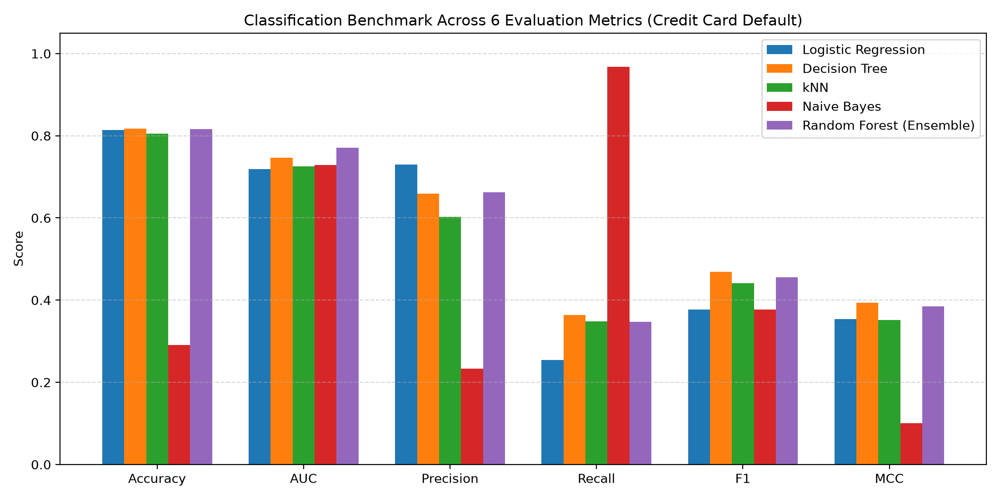
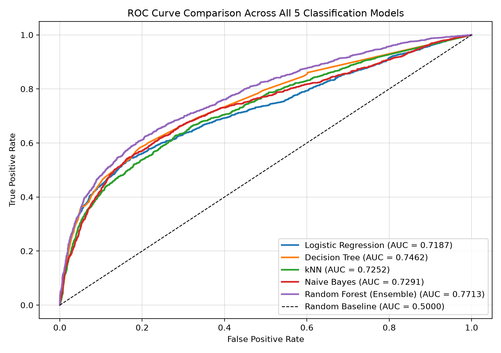

# Credit Card Default Prediction — ML Assignment 2
* **Student Name:** Praneeth (Student ID: `2026ct05121`)
* **Program:** M.Tech (AIML) — Work Integrated Learning Programmes (WILP), BITS Pilani
* **GitHub Repository:** https://github.com/2026ct05121-Praneeth/ml-assignment2

---

## 1. Problem Statement
Credit card issuers face substantial financial risk when cardholders fail to meet minimum monthly payment obligations. Predicting whether a customer will default in the upcoming billing cycle enables risk teams to adjust credit limits, intervene early with payment reminders, and minimize charge-off losses.

This project formulates a binary classification pipeline to predict next-month payment default (`default_next_month = 1` when a client defaults, and `0` otherwise) using demographic, credit limit, repayment history, and billing/payment statement attributes, and systematically benchmarks five distinct supervised classification algorithms across six evaluation metrics.

---

## 2. Dataset Description
* **Dataset Name:** Default of Credit Card Clients Dataset
* **Public Source:** UCI Machine Learning Repository (ID: 350)
* **Selection Rationale:** The dataset exceeds all assignment criteria (**29,965** deduplicated instances vs. 1,000 minimum; **23** input features vs. 12 minimum), exhibits realistic financial class imbalance (~77.9% non-default vs. ~22.1% default), and blends mixed nominal categorical and skewed numerical/ordinal attributes requiring structured preprocessing.
* **Dataset Dimensions:**
  * **Total Instances:** 30,000 initial records (35 exact duplicate rows removed $\rightarrow$ **29,965** unique instances)
  * **Input Features:** **23** features after excluding the unique record identifier (`ID`) and separating the binary target (`default_next_month`)
  * **Train / Test Split:** 80:20 stratified split (**23,972** training instances, **5,993** test instances saved in `test_data.csv`) using `random_state=42`
* **Feature Breakdown:**
  * **Categorical Features (3):** `sex` (gender), `education` (graduate school, university, high school, others), `marriage` (married, single, others).
  * **Numerical & Ordinal Features (20):** `limit_bal` (credit limit in NT dollars), `age` (in years), `pay_0` to `pay_6` (6 months of historical repayment status), `bill_amt1` to `bill_amt6` (6 months of bill statement amounts), `pay_amt1` to `pay_amt6` (6 months of previous payment amounts).
* **Missing Values Handling:**
  * Verified `0` missing values across all columns; configured median imputation (`SimpleImputer(strategy="median")`) + `StandardScaler` for numerical/ordinal features and mode imputation (`SimpleImputer(strategy="most_frequent")`) + `OneHotEncoder(handle_unknown="ignore")` for nominal features inside a `ColumnTransformer` fitted strictly on the 80% training split to prevent data leakage.
* **Target Variable & Class Distribution:**
  * **Class 0 (No Default):** 23,335 instances (77.87%)
  * **Class 1 (Default):** 6,630 instances (22.13%)
  * Stratified splitting preserved this exact ~77.87% / 22.13% class ratio across both training and test sets, and Matthews Correlation Coefficient (MCC) and ROC-AUC were included alongside Accuracy to fairly evaluate performance under class imbalance.

---

## 3. GitHub Repository Structure & Execution Instructions

### Repository Layout
```text
ml-assignment2/
├── requirements.txt
├── README.md
├── test_data.csv
└── model/
    ├── data_pipeline.py
    ├── benchmark_models.py
    ├── results_summary.csv
    ├── metric_comparison.png
    ├── roc_comparison.png
    └── trained_artifacts/
        ├── logistic_regression.pkl
        ├── decision_tree.pkl
        ├── knn.pkl
        ├── naive_bayes.pkl
        └── random_forest_ensemble.pkl
```

### Execution Instructions
```bash
# 1. Clone the repository
git clone [https://github.com/2026ct05121-Praneeth/ml-assignment2.git](https://github.com/2026ct05121-Praneeth/ml-assignment2.git)
cd ml-assignment2

# 2. Install required dependencies
pip install -r requirements.txt

# 3. Fetch dataset, remove duplicates, and generate stratified test_data.csv
python model/data_pipeline.py

# 4. Train all 5 models, evaluate metrics, save artifacts, and generate plots
python model/benchmark_models.py
```

---

## 4. Models Used & Evaluation Comparison Table
All five classification models were trained using identical leakage-free preprocessing pipelines (`StandardScaler` + median imputation for numerical features; `OneHotEncoder(handle_unknown="ignore")` + mode imputation for categorical features fitted exclusively on the 80% training split) and evaluated on the unseen 20% test set (5,993 samples):

| ML Model Name | Accuracy | AUC | Precision | Recall | F1 | MCC |
| :--- | :---: | :---: | :---: | :---: | :---: | :---: |
| Logistic Regression | 0.8141 | 0.7187 | 0.7294 | 0.2541 | 0.3770 | 0.3538 |
| Decision Tree | 0.8176 | 0.7462 | 0.6589 | 0.3643 | 0.4692 | 0.3936 |
| kNN | 0.8049 | 0.7252 | 0.6023 | 0.3484 | 0.4415 | 0.3517 |
| Naive Bayes | 0.2908 | 0.7291 | 0.2338 | 0.9683 | 0.3767 | 0.1000 |
| Random Forest (Ensemble) | 0.8165 | 0.7713 | 0.6624 | 0.3477 | 0.4560 | 0.3852 |

---

## 5. Graphical Representation of Evaluation Metrics

### Comparison Across All 6 Metrics


### ROC Curve Comparison


---

## 6. Model Performance Observations

| ML Model Name | Observation about model performance |
| :--- | :--- |
| **Logistic Regression** | Achieved the highest Precision (**0.7294**) and solid Accuracy (**0.8141**), but recorded the lowest Recall (**0.2541**) and AUC (**0.7187**). Because default risk depends on non-linear thresholds in recent delinquency (`pay_0`, `pay_2`) and utilization ratios (`bill_amt` vs. `limit_bal`), a linear decision boundary predicts conservatively and misses nearly three-quarters of actual defaults. |
| **Decision Tree** | Achieved the highest Accuracy (**0.8176**), F1 (**0.4692**), and MCC (**0.3936**) at the default 0.50 threshold. Depth-regularized splitting (`max_depth=6`, `min_samples_leaf=20`) effectively isolated severe delinquency thresholds (`pay_0 >= 2`), boosting default Recall to **0.3643** while maintaining strong overall balance. |
| **kNN** | Delivered competitive Accuracy (**0.8049**) and MCC (**0.3517**), trailing the tree-based models on AUC (**0.7252**). Distance-weighted voting (`n_neighbors=11`) across 29 standardized/one-hot encoded dimensions suffers slightly from the curse of dimensionality across 12 correlated bill and payment columns. |
| **Naive Bayes** | Exhibited extreme class-imbalance sensitivity—yielding the highest Recall (**0.9683**) and solid probability ranking (**AUC = 0.7291**), but the lowest Accuracy (**0.2908**), Precision (**0.2338**), and MCC (**0.1000**). Gaussian Naive Bayes violates conditional independence across highly correlated sequential monthly bill/payment series and skewed monetary distributions, over-predicting the positive default class. |
| **Random Forest (Ensemble)** | Achieved the strongest overall probability discrimination (**AUC = 0.7713**, outperforming every other model by +0.025 to +0.053 AUC) alongside near-top Accuracy (**0.8165**), Precision (**0.6624**), and MCC (**0.3852**). Averaging 200 regularized trees (`max_depth=10`, `min_samples_leaf=10`) smoothed single-tree variance and captured multi-month repayment interactions most reliably across all operating thresholds. |
| **Overall Winner for your dataset?** | **Random Forest (Ensemble)** is the overall winner for probability ranking and risk scoring (**highest AUC = 0.7713**), while **Decision Tree** leads slightly at the fixed 0.50 classification cutoff (**highest F1 = 0.4692, MCC = 0.3936**). Together, ensemble/tree-based models clearly outperform linear, distance-based, and generative baselines on imbalanced credit default data. |